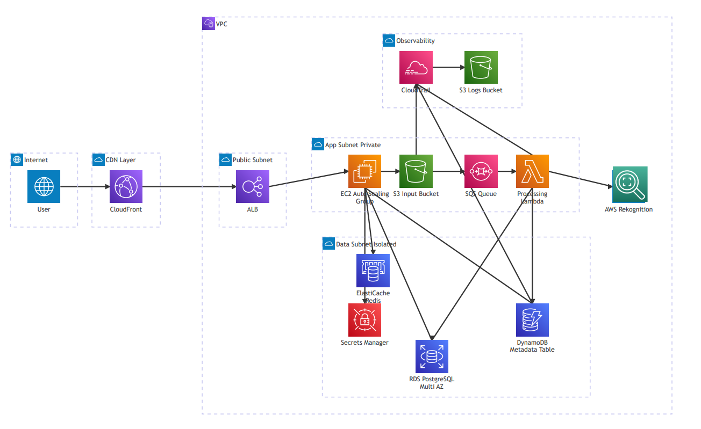

# Cloud Log Sampling: A Labeled AWS CloudTrail Dataset

A labeled dataset of benign and adversarial AWS CloudTrail activity, collected from a live, production-grade cloud deployment and released to support research on log sampling and anomaly detection in cloud audit trails.

The repository contains labeled CloudTrail logs, dataset documentation, and train/test splits used in the accompanying paper.

## Highlights

- **44,798 labeled AWS CloudTrail events**, of which 3,126 (7.0%) are adversarial
- **Record-level labels for every event** - no unlabeled or partially labeled records
- **10 realistic attack scenarios** spanning S3, IAM, and STS
- **Seven attack scenarios reserved exclusively for testing**, enabling zero-shot evaluation
- **Authentic, system-generated logs** captured from a live three-tier AWS deployment
- **Fully anonymized** using consistent, structure-preserving identifier substitution
- Supports log sampling, anomaly detection, and intrusion detection research

## Quick Start

```
TrainOn/
  base_a.zip              16,495 records - benign only
  train_labeled_a.zip      4,216 records - 3,675 benign / 541 attack (3 scenarios)
TestOn/
  TestOn/labeled_cloudtrail_a.zip 24,087 records - 21,502 benign / 2,585 attack (10 scenarios)
```

Each file is a JSON object with a `Records` array of AWS CloudTrail events. Every event carries a boolean `should_sample` label; attack events additionally carry `attack_name`.

```python
import zipfile
import json

with zipfile.ZipFile("TrainOn/train_labeled_a.zip", "r") as z:
    with z.open("train_labeled.json") as f:
        records = json.load(f)["Records"]

labels = [r["should_sample"] for r in records]
```

Full statistics are given in [§5](#5-dataset-statistics), and the label schema in [§6.3](#63-label-schema).

## Reference

If you use this dataset, please cite it as:

> Cloud Log Sampling Dataset, Ariel Cyber Innovation Center, 2026. https://github.com/ArielCyber/cloud_log_sampling

```bibtex
@misc{clouddatasampling2026,
  title  = {Cloud Log Sampling Dataset},
  author = {{Ariel Cyber Innovation Center}},
  year   = {2026},
  url    = {https://github.com/ArielCyber/cloud_log_sampling},
}
```
<!-- ```bibtex
@misc{clouddatasampling2026,
  title  = {Cloud Log Sampling Dataset},
  author = {{Ariel Cyber Innovation Center}},
  year   = {2026},
  url    = {https://github.com/ArielCyber/cloud_log_sampling},
  note   = {Paper forthcoming}
}
``` -->

## 1. Motivation

Evaluating cloud anomaly detection and log sampling systems requires datasets that faithfully reflect both normal and malicious behavior. Existing cloud log datasets suffer from two major limitations: (i) the absence of fine-grained labeling, particularly at the level of the individual log record, and (ii) the limited availability of AWS CloudTrail data, which is the primary source for auditing API-level activity in AWS environments.

To address these limitations, we constructed a controlled yet realistic AWS environment to generate both **benign** and **attack** CloudTrail records. Each log record includes a binary `should_sample` label, and malicious records additionally include the corresponding attack scenario name (`attack_name`). This design enables training of sampling models, systematic evaluation of attack preservation under different sampling strategies, and evaluation of downstream intrusion detection and anomaly detection systems.

### 1.1 Supported Tasks

The dataset is intended to support the following tasks:

- **Cloud log sampling** - learning which records to retain under a constrained sampling budget; `should_sample` provides the retention ground truth.
- **Anomaly detection** - record-level identification of deviations from normal API behavior.
- **Intrusion detection** - scenario-level detection and attribution of adversarial activity via `attack_name`.
- **Semi-supervised learning** - training on the benign-only split and evaluating on the labeled mixed split.
- **One-class learning** - modeling the boundary of normal behavior from `base_a.zip` alone.
- **Representation learning** - learning embeddings of semi-structured CloudTrail events for downstream security tasks.
- **Benchmarking CloudTrail security analytics** - comparing detection and sampling methods on a common, record-level labeled corpus.

Because seven of the ten attack scenarios appear only in the test split ([§6.2](#62-test-data-teston)), the dataset additionally supports evaluation of generalization to previously unseen adversarial behavior.

## 2. Cloud Environment



The dataset is generated from a production-grade AWS deployment organized as a three-tier architecture:

- **Presentation layer** - CloudFront and AWS WAF.
- **Application layer** - auto-scaled EC2 instances running a Flask-based image-sharing application.
- **Data layer** - RDS and Redis services.

Additional AWS managed services (S3, DynamoDB, SQS, Lambda, Rekognition) are integrated to support realistic application workflows, including object storage, asynchronous processing, and event-driven execution. All API-level interactions, whether initiated by end users, the application, or AWS-managed services, are recorded by **AWS CloudTrail** and delivered to Amazon S3 for downstream processing.

## 3. Benign Data Generation

Benign activity is produced by a load-generation framework built on [Locust](https://locust.io), which drives the live application through probabilistically weighted user personas. Four primary user types are modeled:

| Persona     |Behavior                                                                  |
|-------------|---------------------------------------------------------------------------|
| **Viewer**  | Read-heavy operations: browsing the feed, viewing image details, downloading content. |
| **Creator** | Content creation: uploading images, tagging, versioning.                  |
| **Editor**  | Content curation: tag management, version deletion, image removal.        |
| **Admin**   | Account-lifecycle and system-level actions: profile and credential updates. |

Each persona has its own task mix, think-time distribution, and session dynamics (variable session length, re-authentication, and a mix of returning and new-visitor identities). The probabilistic weighting yields a realistic traffic distribution in which read operations dominate and administrative actions remain rare. Realism is further increased through geographically diverse source IP addresses, heterogeneous user agents (browser, CLI, and script clients), and session-structured interaction patterns (login, activity, logout) at variable request rates.

The generation pipeline proceeds end to end: simulated users interact with the deployed application; requests are served by the AWS services behind it; CloudTrail records every resulting API call; and the logs are collected from Amazon S3. Consequently, all records in the dataset are **authentic, system-generated events** rather than synthetic or hand-crafted data.

## 4. Attack Scenario Generation

Ten controlled attack scenarios were executed against the same live environment, spanning three AWS surfaces (S3, IAM, STS). For each scenario the exact execution time window is recorded; the corresponding CloudTrail records are then merged with the benign stream and labeled with `should_sample = true` and the appropriate `attack_name`.

The attack set deliberately spans **high-volume** attacks (mass object operations), **low-volume, stealthy** attacks (single critical IAM or STS actions), and **multi-stage attack chains** (persistence and privilege escalation sequences), enabling evaluation of detector and sampler robustness across attack profiles ranging from noisy anomalies to subtle deviations and complex behavioral sequences.

### 4.1 Data Manipulation and Exfiltration

- **Mass Get Objects (single and multiple buckets)** - high-volume retrieval of S3 objects, indicative of data exfiltration.
- **Mass Put Objects (single and multiple buckets)** - large-scale overwrite operations, simulating data corruption or ransomware behavior.
- **Mass Delete Objects (single and multiple buckets)** - bulk object deletion, representing destructive attacks on stored data.

### 4.2 Misconfiguration and Identity Abuse

- **Anonymous Bucket Access** - successful API calls by unauthenticated principals, exposing publicly accessible resources.
- **S3 Activity Using Penetration-Testing Tools** - automated enumeration patterns with unusual API calls, characteristic of reconnaissance tooling.
- **Federation Token for Root User** - minting of federated session credentials for the root account, indicative of privilege escalation.

### 4.3 Persistence and Privilege Escalation

This scenario simulates a compromised valid account (MITRE ATT&CK T1078) executing a structured, multi-stage intrusion chain:

1. **Reconnaissance** (T1087, T1580) - enumeration of IAM users and S3 buckets to map the environment and identify escalation targets.
2. **Account Manipulation** (T1098) - attachment of administrative policies to an existing IAM user, silently escalating privileges without creating new accounts.
3. **Impair Defenses** (T1562) - weakening of the security posture by relaxing password-policy requirements, lowering the barrier to future unauthorized access.

Because each stage depends on the preceding one, and each individual action may appear legitimate in isolation, this chain is particularly challenging to detect.

### 4.4 Scenario Summary

| # | Name | Surface | Description |
|---|------|---------|-------------|
| 0 | `AnonymousS3Calls` | S3 | Anonymous (unsigned) access to S3 buckets |
| 1 | `MassDeleteSingleBucket` | S3 | Mass object deletion from a single bucket |
| 2 | `MassDeleteMultipleBuckets` | S3 | Mass object deletion across multiple buckets |
| 3 | `MassGetSingleBucket` | S3 | Mass object enumeration/download from a single bucket |
| 4 | `MassGetMultipleBuckets` | S3 | Mass object enumeration/download across multiple buckets |
| 5 | `MassPutSingleBucket` | S3 | Mass object upload to a single bucket |
| 6 | `MassPutMultipleBuckets` | S3 | Mass object upload across multiple buckets |
| 7 | `RootFederationTokenGeneration` | STS | Federation token minting for privilege escalation |
| 8 | `AnonymousS3PentestWeirdAPIs` | S3 | Anonymous S3 probing with unusual API calls |
| 9 | `FullPersistenceCreationChain` | IAM | Full IAM persistence chain (user, keys, policies) |

## 5. Dataset Statistics

The distributed corpus comprises **44,798** CloudTrail records, of which **3,126** (7.0%) are labeled as anomalous. The distribution exhibits a realistic class imbalance between routine activity and rare security events, while covering a diverse set of attack behaviors.

| Split | Benign | Anomalous | Total | Anomaly rate |
|---|---:|---:|---:|---:|
| Training (`TrainOn/`) | 20,170 | 541 | 20,711 | 2.6% |
| Test (`TestOn/`) | 21,502 | 2,585 | 24,087 | 10.7% |
| **Corpus** | **41,672** | **3,126** | **44,798** | **7.0%** |

Per-scenario anomaly counts:

| Attack scenario | Train | Test | Total |
|---|---:|---:|---:|
| `MassPutMultipleBuckets` | 0 | 542 | 542 |
| `MassGetMultipleBuckets` | 519 | 535 | 1,054 |
| `MassPutSingleBucket` | 0 | 520 | 520 |
| `MassDeleteMultipleBuckets` | 0 | 510 | 510 |
| `MassDeleteSingleBucket` | 0 | 302 | 302 |
| `MassGetSingleBucket` | 4 | 123 | 127 |
| `AnonymousS3PentestWeirdAPIs` | 0 | 25 | 25 |
| `AnonymousS3Calls` | 18 | 17 | 35 |
| `FullPersistenceCreationChain` | 0 | 10 | 10 |
| `RootFederationTokenGeneration` | 0 | 1 | 1 |
| **Total** | **541** | **2,585** | **3,126** |

Note the extreme variation in anomaly cardinality, from a single record (`RootFederationTokenGeneration`) to several hundred (`MassPutMultipleBuckets`). Detection and sampling performance should therefore be reported per scenario in addition to aggregate metrics, since micro-averaged results are dominated by the high-volume S3 scenarios.

## 6. Distributed Files

The dataset is organized into predefined train/test splits designed to evaluate generalization to previously unseen attacks.

### 6.1 Training Data (`TrainOn/`)

| File                  | Records | Benign | Anomalous | Content |
|-----------------------|---:|---:|---:|---|
| `base_a.zip`          | 16,495 | 16,495 | 0 | Benign CloudTrail records only. Intended for semi-supervised or one-class training, and as a reference distribution of normal behavior. |
| `train_labeled_a.zip` | 4,216 | 3,675 | 541 | Mixed benign and attack records with `should_sample` labels, for supervised training. |

Attack scenarios present in `train_labeled_a.zip`:

| Scenario | Records |
|---|---:|
| `MassGetMultipleBuckets` | 519 |
| `AnonymousS3Calls` | 18 |
| `MassGetSingleBucket` | 4 |

### 6.2 Test Data (`TestOn/`)

| File | Records | Benign | Anomalous | Content |
|---|---:|---:|---:|---|
| `labeled_cloudtrail_a.zip` | 24,087 | 21,502 | 2,585 | Labeled test set in which benign and attack activity were executed **concurrently**, rather than recorded in isolation and merged afterwards. Covers all ten attack scenarios. |

Attack scenarios present in the test set:

| Scenario | Records |
|---|---:|
| `MassPutMultipleBuckets` | 542 |
| `MassGetMultipleBuckets` | 535 |
| `MassPutSingleBucket` | 520 |
| `MassDeleteMultipleBuckets` | 510 |
| `MassDeleteSingleBucket` | 302 |
| `MassGetSingleBucket` | 123 |
| `AnonymousS3PentestWeirdAPIs` | 25 |
| `AnonymousS3Calls` | 17 |
| `FullPersistenceCreationChain` | 10 |
| `RootFederationTokenGeneration` | 1 |
| **Total** | **2,585** |

The training split intentionally covers only three of the ten attack scenarios, so that the test split measures generalization to previously unseen adversarial behavior in addition to in-distribution detection.

### 6.3 Label Schema

Each record is a standard AWS CloudTrail event object augmented with the following fields:

| Field | Type | Description |
|---|---|---|
| `should_sample` | boolean | Ground-truth label. `true` for records produced by an attack scenario, `false` for benign records. Present on every record. |
| `attack_name` | string | Present only when `should_sample` is `true`; identifies the originating scenario (see [§4.4](#44-scenario-summary)). |

All record counts and label distributions reported in [§5](#5-dataset-statistics) and [§6](#6-distributed-files) were obtained by direct enumeration of the distributed files.

### 6.4 Anonymization

**All distributed records, in both the training and test splits, have been anonymized.** No real AWS account identifiers, principal identifiers, credentials, or human user names remain in the released files. Anonymization is applied by `anonymize.py`, which rewrites the following fields in every record:

| Field | Treatment |
|---|---|
| `userIdentity.accountId`, `recipientAccountId` | Replaced with a randomly generated 12-digit identifier. |
| `userIdentity.principalId` | Replaced, preserving the AWS type prefix (e.g. `AIDA`, `AROA`). |
| `userIdentity.accessKeyId` | Replaced, preserving the type prefix (e.g. `AKIA`, `ASIA`). |
| `userIdentity.userName` (IAM users) | Replaced with a sequential pseudonym (`user1`, `user2`, …). |
| `userIdentity.arn`, `sessionContext.sessionIssuer` | Rewritten to remain consistent with the substituted values above. |
| `sourceIPAddress` | Host portion randomized; the first two octets are retained so that network locality is preserved. |
| `responseElements.credentials`, `responseElements.federatedUser` | Access keys and federated-user identifiers replaced. |

The mapping is **injective and consistent across the entire corpus**: a given original value is always replaced by the same surrogate, and distinct original values never collapse onto the same surrogate. Identity-linkage structure is therefore preserved, the number of distinct principals, which events share a principal or a source address, and session groupings are all unchanged, so anonymization does not weaken the dataset for behavioral or sequence-based modeling. A final sweep propagates the substitutions into free-text and nested fields (resource ARNs, bucket names,policy documents, host headers) so that no original identifier survives in an unstructured field.

Service-linked and infrastructure role names (for example `CloudEnvironmentStack-AppASGInstanceRole`) are retained, since they describe the deployment architecture rather than a person, and are required to interpret the workload. Event timestamps, API names, event sources, request parameters, and all label fields are left untouched, so the temporal and behavioral signal used by detection and sampling methods is fully preserved.

## 7. Record Examples

The examples below use illustrative placeholder identifiers and truncated user-agent strings for readability; the distributed files contain anonymized surrogates of the same form, as described in [§6.4](#64-anonymization).

### 7.1 Benign:  Application Data-Plane Event

A DynamoDB `GetItem` call issued by an EC2 instance through its IAM instance role.`should_sample = false` marks the record as benign.

```json
{
  "eventVersion": "1.11",
  "userIdentity": {
    "type": "AssumedRole",
    "principalId": "AROAXXXXXXXXXXXXXXXXX:i-xxxxxxxxxxxxxxxxx",
    "arn": "arn:aws:sts::123456789012:assumed-role/ExampleStack-AppASGInstanceRole/i-xxxxxxxxxxxxxxxxx",
    "accountId": "123456789012",
    "accessKeyId": "ASIAXXXXXXXXXXXXXXXXX",
    "sessionContext": {
      "sessionIssuer": {
        "type": "Role",
        "principalId": "AROAXXXXXXXXXXXXXXXXX",
        "arn": "arn:aws:iam::123456789012:role/ExampleStack-AppASGInstanceRole",
        "accountId": "123456789012",
        "userName": "ExampleStack-AppASGInstanceRole"
      },
      "attributes": {
        "creationDate": "2026-02-18T05:25:41Z",
        "mfaAuthenticated": "false"
      },
      "ec2RoleDelivery": "2.0"
    }
  },
  "eventTime": "2026-02-18T10:58:50Z",
  "eventSource": "dynamodb.amazonaws.com",
  "eventName": "GetItem",
  "awsRegion": "us-east-1",
  "sourceIPAddress": "10.0.x.x",
  "userAgent": "Boto3/1.42.51 md/Botocore#1.42.51 ...",
  "requestParameters": {
    "tableName": "ExampleStack-MetadataTable",
    "key": {
      "sk": "META",
      "image_id": "IMAGE#xxxxxxxx-xxxx-xxxx-xxxx-xxxxxxxxxxxx"
    }
  },
  "responseElements": null,
  "requestID": "XXXXXXXXXXXXXXXXXXXXXXXXXXXXXXXXXXXXXXXXXXXXXXXXXXXXXXXX",
  "eventID": "xxxxxxxx-xxxx-xxxx-xxxx-xxxxxxxxxxxx",
  "readOnly": true,
  "resources": [
    {
      "accountId": "123456789012",
      "type": "AWS::DynamoDB::Table",
      "ARN": "arn:aws:dynamodb:us-east-1:123456789012:table/ExampleStack-MetadataTable"
    }
  ],
  "eventType": "AwsApiCall",
  "managementEvent": false,
  "eventCategory": "Data",
  "should_sample": false
}
```

### 7.2 Benign:  Console Management Event

A read-only management API call issued by an IAM user through the AWS Console.

```json
{
  "eventVersion": "1.09",
  "userIdentity": {
    "type": "IAMUser",
    "principalId": "AIDAXXXXXXXXXXXXXXXXX",
    "arn": "arn:aws:iam::123456789012:user/ExampleUser",
    "accountId": "123456789012",
    "accessKeyId": "ASIAXXXXXXXXXXXXXXXXX",
    "userName": "ExampleUser",
    "sessionContext": {
      "attributes": {
        "creationDate": "2026-02-20T14:05:03Z",
        "mfaAuthenticated": "true"
      }
    }
  },
  "eventTime": "2026-02-20T14:28:53Z",
  "eventSource": "notifications.amazonaws.com",
  "eventName": "ListManagedNotificationEvents",
  "awsRegion": "us-east-1",
  "sourceIPAddress": "x.x.x.x",
  "userAgent": "Mozilla/5.0 (Windows NT 10.0; Win64; x64) AppleWebKit/537.36 ...",
  "requestParameters": {
    "maxResults": "100",
    "locale": "en_US"
  },
  "responseElements": null,
  "requestID": "xxxxxxxx-xxxx-xxxx-xxxx-xxxxxxxxxxxx",
  "eventID": "xxxxxxxx-xxxx-xxxx-xxxx-xxxxxxxxxxxx",
  "readOnly": true,
  "eventType": "AwsApiCall",
  "managementEvent": true,
  "recipientAccountId": "123456789012",
  "eventCategory": "Management",
  "sessionCredentialFromConsole": "true",
  "should_sample": false
}
```

### 7.3 Attack: `RootFederationTokenGeneration`

An IAM user calls `GetFederationToken` to mint a federated session, the rarest event class in the corpus (a single record), usable to escalate or pivot privileges. `should_sample = true` marks the record as malicious, and `attack_name` identifies the scenario.

```json
{
  "eventVersion": "1.11",
  "userIdentity": {
    "type": "IAMUser",
    "principalId": "AIDAXXXXXXXXXXXXXXXXX",
    "arn": "arn:aws:iam::123456789012:user/ExampleUser",
    "accountId": "123456789012",
    "accessKeyId": "AKIAXXXXXXXXXXXXXXXXX",
    "userName": "ExampleUser"
  },
  "eventTime": "2026-04-04T16:45:22Z",
  "eventSource": "sts.amazonaws.com",
  "eventName": "GetFederationToken",
  "awsRegion": "us-east-1",
  "sourceIPAddress": "x.x.x.x",
  "userAgent": "Boto3/1.42.22 md/Botocore#1.42.22 ua/2.1 os/windows#11 ...",
  "requestParameters": {
    "name": "root-federation-xxxxxxxxxxxx",
    "durationSeconds": 900
  },
  "responseElements": {
    "credentials": {
      "accessKeyId": "ASIAXXXXXXXXXXXXXXXXX",
      "sessionToken": "<REDACTED>",
      "expiration": "Apr 4, 2026, 5:00:22 PM"
    },
    "federatedUser": {
      "federatedUserId": "123456789012:root-federation-xxxxxxxxxxxx",
      "arn": "arn:aws:sts::123456789012:federated-user/root-federation-xxxxxxxxxxxx"
    },
    "packedPolicySize": 0
  },
  "additionalEventData": {
    "ExtendedRequestId": "<REDACTED>",
    "RequestDetails": {
      "awsServingRegion": "us-east-1",
      "endpointType": "regional"
    }
  },
  "requestID": "xxxxxxxx-xxxx-xxxx-xxxx-xxxxxxxxxxxx",
  "eventID": "xxxxxxxx-xxxx-xxxx-xxxx-xxxxxxxxxxxx",
  "readOnly": false,
  "eventType": "AwsApiCall",
  "managementEvent": true,
  "recipientAccountId": "123456789012",
  "eventCategory": "Management",
  "tlsDetails": {
    "tlsVersion": "TLSv1.3",
    "cipherSuite": "TLS_AES_128_GCM_SHA256",
    "clientProvidedHostHeader": "sts.us-east-1.amazonaws.com"
  },
  "should_sample": true,
  "attack_name": "RootFederationTokenGeneration"
}
```
